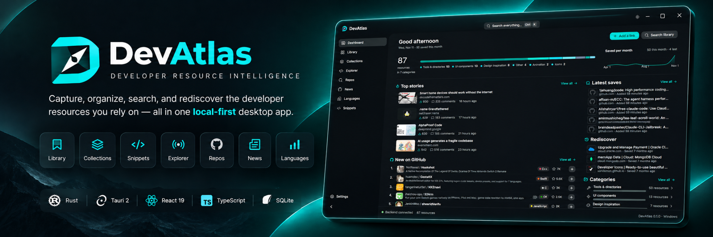
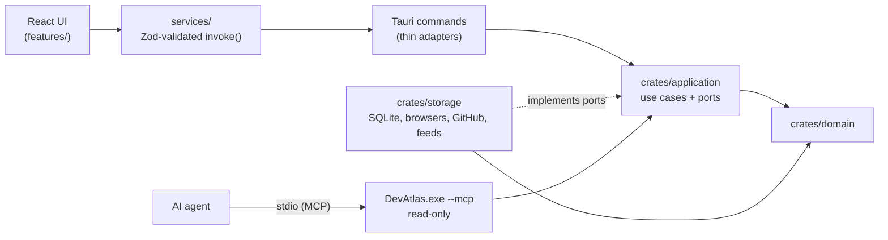

<div align="center">



# DevAtlas: a local-first bookmark manager for developers, with an MCP server for AI coding agents

**Every developer resource you rely on, in one place your AI agents can read.**

[Website](https://sakithasamarathunga33.github.io/devatlas/) ·
[Download for Windows](https://github.com/SakithaSamarathunga33/devatlas/releases/latest) ·
[Use with Claude Code and Cursor](#use-with-ai-coding-agents-mcp) · [FAQ](#faq)

[](https://github.com/SakithaSamarathunga33/devatlas/releases/latest)
[](https://github.com/SakithaSamarathunga33/devatlas/actions/workflows/ci.yml)
[](https://github.com/SakithaSamarathunga33/devatlas/actions/workflows/release.yml)
[](https://tauri.app)
[](https://www.rust-lang.org)
[](https://react.dev)
[](https://www.typescriptlang.org)
[](LICENSE)

_A local-first Windows desktop app built with **Tauri 2, Rust and React** that turns your browser
bookmarks, GitHub stars and saved links into one searchable library: collections, snippets, an
Explorer of suggested links, trending repos and star history, news from official blogs, language
rankings, a dead-link checker, backups, and a read-only MCP server so Claude Code, Cursor and other
coding agents can answer from what you saved. No account, no cloud, nothing written to your browser._

</div>

---

## Contents

- [Features](#features)
- [Use with AI coding agents (MCP)](#use-with-ai-coding-agents-mcp)
- [Design system](#design-system)
- [Architecture](#architecture)
- [Project layout](#project-layout)
- [Getting started](#getting-started)
- [Configuration](#configuration)
- [Build and release](#build-and-release)
- [Testing and quality](#testing-and-quality)
- [Security](#security)
- [Troubleshooting](#troubleshooting)
- [Roadmap](#roadmap)
- [FAQ](#faq)
- [Contributing](#contributing)
- [License](#license)

---

## Features

### Dashboard

- Time-of-day greeting, how many resources you have and how many you saved this month, and a bar
  of your library by category.
- **Saved per month** chart, the **Top stories** developers are discussing, **New on GitHub**
  (this week's top five new repositories, one click to save), **Latest saves**, a **Rediscover**
  panel that resurfaces links you forgot, and your categories at a glance.
- **Ctrl K** searches everything: links (titles, notes and tags), collections, snippets and pages.

### Library

- Reads **one bookmark folder live** from Brave, Chrome (including signed-in account bookmarks),
  Edge, Vivaldi, Opera, Opera GX or Firefox, chosen in **Settings**, or none (only links you add).
  Bookmarks are read, never written: removing one in DevAtlas only hides it there.
- Links are cleaned, de-duplicated and sorted into UI components, design inspiration, animation,
  icons, tools and cloud consoles. Links you save in the browser appear within a few seconds with
  a **New** tag (until you open them, or for 7 days).
- **Add link**: paste an address and DevAtlas fetches its title and preview image and files it
  under the right category.
- **Edit** any link to change its category, add tags and write **Why it's here**, the note your
  AI agents read.
- **GitHub stars import**: bring in up to 1,000 repositories any GitHub user starred.
- Cards show each site's preview image, and sites open in a viewer inside DevAtlas.
- **Reading status** for each link.

### Organize

- **Collections**: named groups of links.
- **Snippets**: code snippets, which can be attached to a link.
- **Explorer**: your library plus suggested links by language and framework. Remove any suggestion
  you don't want, and restore them later.

### Discover

- **Repos**: new GitHub repositories collecting the most stars today, this week or this month,
  optionally by language, with one-click **Save**. Rows expand to show each repository's star
  history chart from [star-history.com](https://www.star-history.com). GitHub has no API for its
  Trending page, so this uses the official Search API (repositories created in the period, most
  stars first), cached for 15 minutes.
- **Star History**: that site's rankings of repositories of any age: Weekly (biggest gainers),
  All-time, Random and Pyramid (how stars are distributed).
- **Saved repos**: the GitHub repositories in your library as cards or rows, with search,
  language and sort filters, their latest release and recent star growth (cached for an hour;
  release checks are kept for six).
- **News**: the Hacker News front page and the latest posts from 35 official blogs, grouped into
  languages, frameworks, databases and tools & platforms, each with its logo. Feeds are read in
  Rust from a fixed allow-list and cached for 30 minutes. A **For you** filter keeps the stories that
  match your tags and library (also on Repos).
- **Languages**: how popular programming languages are, from the two indexes that update monthly
  (TIOBE and PYPL), side by side, with each language's movement over the last year.

### AI coding agents

- The installed app doubles as an **MCP server** (`DevAtlas.exe --mcp`), so Claude Code, Cursor,
  Windsurf and Codex can search your library, read why you saved each link, and see which saved
  resources match a project's dependencies. Read-only. See
  [Use with AI coding agents](#use-with-ai-coding-agents-mcp).

### Your data

- **Local-first**: the library lives in a SQLite database in your app-data folder. There is no
  account and no server.
- **Backup and import**: export everything to one file; import a DevAtlas backup or any browser's
  bookmarks export. Importing merges and never removes anything.
- **Dead-link checker**: finds links that are gone or have moved.
- **GitHub token** (optional): raises GitHub's rate limit. It is kept in the Windows Credential
  Manager, never in a file.
- **Light and dark** themes.

### Installer

- **DevAtlas Setup**, a step-by-step wizard: welcome, license, install options, live progress,
  finish. It installs per user to `%LOCALAPPDATA%\Programs\DevAtlas` (no admin prompt), can add
  desktop and Start Menu shortcuts, and registers in **Settings → Apps**. Uninstalling keeps your
  library.

---

## Use with AI coding agents (MCP)

DevAtlas includes an [MCP](https://modelcontextprotocol.io) server, so your coding agent can use
the library you built instead of guessing. Ask it "which date picker did I save?" or "what do I
have saved for this project's stack?" and it answers from your own links and notes.

The installed app is the server: an agent starts `DevAtlas.exe --mcp` and talks to it over
stdin/stdout. DevAtlas does not need to be open.

### Connect an agent

Open **Settings → AI coding agents** in DevAtlas. It shows both of these with the real path of
your installed copy, ready to copy.

**Claude Code** (available in every folder):

```bash
claude mcp add devatlas -s user -- "C:\Users\<you>\AppData\Local\Programs\DevAtlas\DevAtlas.exe" --mcp
```

**Cursor, Windsurf, Codex and other agents** read an `mcp.json`:

```json
{
  "mcpServers": {
    "devatlas": {
      "command": "C:\\Users\\<you>\\AppData\\Local\\Programs\\DevAtlas\\DevAtlas.exe",
      "args": ["--mcp"]
    }
  }
}
```

Run `claude mcp list` (or the agent's own MCP view) to check that `devatlas` is connected.

### Tools

| Tool                | What the agent gets                                                                                                                                                  |
| ------------------- | -------------------------------------------------------------------------------------------------------------------------------------------------------------------- |
| `search_library`    | Saved resources matching every word of a query, each with your "why it's here" note.                                                                                 |
| `get_resource`      | One resource by id or address: note, tags, collections, reading status, link health and attached code snippets.                                                      |
| `get_project_stack` | The dependencies of a project in the agent's folder (`package.json`, `Cargo.toml`, `go.mod`, `pyproject.toml`, `requirements.txt`) and which of them you have saved. |

### Privacy and safety

- **Read-only.** The server opens the library database read-only and cannot add, change or delete
  anything.
- **Local only.** Nothing leaves your computer: the agent and DevAtlas talk over a local pipe.
- **Confined.** `get_project_stack` only reads inside the folder the agent was started in. It
  refuses network paths and skips symbolic links.
- **Untrusted text is cleaned.** Titles and descriptions from websites have hidden and control
  characters removed and are marked as data, so a saved page cannot give the agent instructions.
- Each lookup is counted in `agent-lookups.jsonl` in the app's data folder. Settings shows the
  count for the last 7 days.

Write the reason you saved a link in its **Why it's here** field (the **Edit** button on any
Library card): that note is what makes the agent's answers useful.

---

## Design system

Both apps are built on [Astryx](https://github.com/meta/astryx) (`@astryxdesign/core`) with a
custom DevAtlas theme, so screens share one set of components and tokens.

| Piece      | Where                                | Notes                                                                                                             |
| ---------- | ------------------------------------ | ----------------------------------------------------------------------------------------------------------------- |
| Theme      | `apps/desktop/src/themes/devatlas`   | The DevAtlas theme built with `astryx theme build`: teal accent, neutral charcoal surfaces, Geist and Geist Mono. |
| Components | `@astryxdesign/core`                 | App shell, side and top navigation, lists, tables, cards, dialogs, selectors, banners, empty and error states.    |
| Layout     | Tailwind CSS 4                       | Layout only. Colours, type and spacing come from Astryx tokens, never hex values.                                 |
| Charts     | `apps/desktop/src/components/charts` | Area charts (d3-scale, d3-shape) for saves per month and star history.                                            |
| Icons      | Lucide, Simple Icons                 | Interface icons, and brand logos for blogs and languages.                                                         |
| Installer  | `apps/installer`                     | The same theme in a 560×600 wizard with a stepper, progress bar and banners.                                      |

Look components up with `pnpm exec astryx search "<what you need>"` and
`pnpm exec astryx component <Name>` inside `apps/desktop`.

---

## Architecture



- **Layers**: `domain` holds core concepts with no infrastructure. `application` holds the use
  cases and the ports (traits) they need, and depends on `domain` only. `storage` implements those
  ports. The Tauri commands in `apps/desktop/src-tauri` are thin adapters that call the
  application layer; they never hold business logic or call storage directly. Full rules:
  [dependency rules](docs/architecture/dependency-rules.md).
- **Frontend**: TanStack Query for backend data, Zustand only for shared UI state, component state
  for the rest. Every IPC payload is validated with Zod at the boundary.
- **Least privilege**: each Tauri command is listed in `build.rs` and granted one by one in
  `capabilities/default.json`. No `fs`, `shell` or `http` plugins.
- **MCP mode**: `DevAtlas.exe --mcp` skips the window and serves the
  [rmcp](https://github.com/modelcontextprotocol/rust-sdk) server over stdin/stdout, with the
  database opened read-only.

**Pages**

| Route          | Page                                                        |
| -------------- | ----------------------------------------------------------- |
| `/`            | Dashboard                                                   |
| `/library`     | Library (`/library/:resourceId` for one resource)           |
| `/collections` | Collections (`/collections/:groupId` for one)               |
| `/explorer`    | Explorer                                                    |
| `/discovery`   | Repos: New, Star History and Saved repos                    |
| `/news`        | News                                                        |
| `/rankings`    | Languages                                                   |
| `/snippets`    | Snippets                                                    |
| `/settings`    | Settings                                                    |
| `/…/view`      | The in-app site viewer, opened from Repos, News or Explorer |

**Data on disk** (`%APPDATA%\com.devatlas.app`)

| File                  | Contents                                                                                                           |
| --------------------- | ------------------------------------------------------------------------------------------------------------------ |
| `devatlas.db`         | SQLite: collections, snippets, edits, repo history, removed suggestions (`devatlas-dev.db` for development builds) |
| JSON files            | Settings, saved links and caches (previews, news, rankings, star history)                                          |
| `agent-lookups.jsonl` | One line per AI agent lookup, pruned to 30 days                                                                    |

**Tech stack**

| Area            | Choice                                                                                 |
| --------------- | -------------------------------------------------------------------------------------- |
| Desktop runtime | Tauri 2, WebView2, Rust (stable, edition 2024)                                         |
| Frontend        | React 19, TypeScript 6, Vite 8, React Router                                           |
| UI              | Astryx, Tailwind CSS 4 (layout), Lucide and Simple Icons, Geist fonts, Sonner (toasts) |
| State and data  | TanStack Query, Zustand, Zod, React Hook Form                                          |
| Charts          | d3-scale, d3-shape                                                                     |
| Rust            | SQLx (SQLite), reqwest, rmcp, serde, tracing, toml, keyring, winreg                    |
| Tooling         | pnpm 10 workspaces, Cargo workspace, ESLint, Prettier, Vitest, rustfmt, Clippy         |

TypeScript is pinned to 6.0.x because `typescript-eslint` does not yet support TypeScript 7.

---

## Project layout

```text
apps/
├── desktop/
│   ├── src/                   # React frontend
│   │   ├── app/               # Providers, router, layouts
│   │   ├── components/        # layout/, shared/, charts/
│   │   ├── features/          # dashboard, library, collections, explorer, discovery, news, …
│   │   ├── hooks/ lib/ services/ stores/ types/ styles/ themes/
│   │   └── test/              # Vitest setup
│   └── src-tauri/             # Rust delivery layer: commands, MCP server, capabilities, config
└── installer/                 # DevAtlas Setup, the custom install wizard
crates/
├── domain/                    # Core concepts, no infrastructure
├── application/               # Use cases and ports, depends on domain only
└── storage/                   # SQLite + migrations, browser bookmarks, GitHub, feeds, manifests
docs/                          # Architecture, database, security, decisions, Windows setup, README images
scripts/                       # release-notes.sh (+ its test), used by the release workflow
.github/workflows/             # ci.yml (checks + Windows build), release.yml (publishing)
AGENTS.md                      # Guidance for AI coding agents working in this repo
```

`packages/` is reserved in `pnpm-workspace.yaml` for shared contracts once they exist.

---

## Getting started

### Prerequisites

| Tool                      | Notes                                                                                                               |
| ------------------------- | ------------------------------------------------------------------------------------------------------------------- |
| Node.js ≥ 22.22           | CI uses Node 24                                                                                                     |
| pnpm 10                   | `corepack enable` or `npm i -g pnpm@10`                                                                             |
| Rust stable (MSVC)        | Install with [rustup](https://rustup.rs). `rust-toolchain.toml` selects the channel and adds `rustfmt` and `clippy` |
| C++ Build Tools, WebView2 | See [docs/development/windows-setup.md](docs/development/windows-setup.md). WebView2 ships with Windows 10 and 11   |

### Set up

```bash
git clone https://github.com/SakithaSamarathunga33/devatlas.git
cd devatlas
pnpm install
```

No accounts or keys are needed.

### Run

```bash
pnpm dev     # Vite dev server + the Tauri window, with hot reload
```

The frontend also opens in a regular browser with `pnpm --filter @devatlas/desktop dev`, but the
Rust backend is only reachable inside the Tauri window; the status bar says so.

---

## Configuration

Everything is set in the app's **Settings** page:

| Setting           | Purpose                                                                                                 |
| ----------------- | ------------------------------------------------------------------------------------------------------- |
| Browser bookmarks | Which browser, profile and bookmark folder the Library reads, or none                                   |
| GitHub token      | Optional. Raises GitHub's API limit for Repos and Saved repos. Stored in the Windows Credential Manager |
| GitHub stars      | Import the starred repositories of any GitHub username                                                  |
| AI coding agents  | The commands to connect an agent, and how many lookups agents made this week                            |
| Library tools     | Dead-link check, backup, and import from a backup or a browser's bookmarks file                         |

The release workflow needs no secrets: it uses the built-in `GITHUB_TOKEN`.

---

## Build and release

### Local build

```bash
pnpm build             # Release build + standard Windows installers (NSIS .exe and .msi)
pnpm build:installer   # Builds DevAtlas, then DevAtlas Setup with the app embedded
```

`pnpm build` writes installers to `target/release/bundle/`. `pnpm build:installer` writes
`target/release/devatlas-installer.exe`, the single-file setup wizard. To work on the wizard UI,
run `pnpm --filter @devatlas/installer tauri dev`; its Install button reports that no app is
embedded until `pnpm build:installer` has run once.

### Releasing with GitHub Actions

Every push to `main` that passes CI publishes a release. Nothing to tag by hand.

1. `ci.yml` runs the frontend checks (Ubuntu), the Rust checks (Windows), then the Windows build,
   which uploads the installers.
2. When CI succeeds on a push, `release.yml` downloads those installers.
3. It names the release `v<version>-build.<CI run>` (the version comes from `Cargo.toml`).
4. `scripts/release-notes.sh` writes the notes: every commit since the previous release, grouped
   into **New**, **Fixes** and **Other changes**, each with its message body.
5. It publishes the GitHub release with the three installers attached. A re-run never duplicates a
   release.

Pushes that only change docs (Markdown files, `docs/`, `LICENSE`) skip CI and publish nothing.
Pull requests run every check but never release.

### Installing a release

Download from the [Releases](https://github.com/SakithaSamarathunga33/devatlas/releases) page:

- `DevAtlas-Setup-<tag>.exe`: the setup wizard (recommended).
- `DevAtlas_<version>_x64-setup.exe` and `DevAtlas_<version>_x64_en-US.msi`: standard installers.

Run the new installer over the old one to update; your library is kept. There is no in-app
updater, so check the Releases page.

---

## Testing and quality

| Command             | What it runs                                            |
| ------------------- | ------------------------------------------------------- |
| `pnpm typecheck`    | `tsc --noEmit` for both apps                            |
| `pnpm lint`         | ESLint (type-aware, React Hooks, React Refresh)         |
| `pnpm test`         | Vitest for both apps, then `cargo test --workspace`     |
| `pnpm format:check` | Prettier                                                |
| `pnpm rust:fmt`     | `cargo fmt --all -- --check`                            |
| `pnpm rust:clippy`  | `cargo clippy --workspace --all-targets -- -D warnings` |

- **Frontend**: Vitest and Testing Library for every page and shared component, with
  `@tauri-apps/api/core` mocked at the module boundary.
- **Rust**: unit tests next to the code for use cases, search and stack matching, bookmark readers
  for every browser (against fixture files), manifest parsing, the read-only database, the MCP
  server's path confinement, and the install-location lookup.
- **Scripts**: `scripts/release-notes.test.sh` checks the notes against a throwaway repository.
- CI runs all of these on every push and pull request; Clippy warnings fail the build.

---

## Security

- A strict Content Security Policy and no remote scripts.
- Least-privilege Tauri capabilities: one permission per command, no file system, shell or HTTP
  plugins.
- Paths come from the OS, never hard-coded, and file dialogs run in Rust so the webview never
  supplies a path.
- Browser data is read-only. Firefox's database is copied before reading, so it works while
  Firefox is open.
- `unsafe` Rust is forbidden workspace-wide, and production code has no `unwrap()`.

Details: [security model](docs/security/security-model.md).

---

## Troubleshooting

| Symptom                                                   | Cause and fix                                                                                                                                 |
| --------------------------------------------------------- | --------------------------------------------------------------------------------------------------------------------------------------------- |
| Windows SmartScreen warns about the installer             | Releases are not code-signed yet. Choose **More info → Run anyway**.                                                                          |
| The installer can't replace `DevAtlas.exe`                | An AI agent is running DevAtlas as its MCP server. Quit the agent (for example Claude Code), then install again.                              |
| Settings → AI coding agents shows a `target\release` path | DevAtlas isn't installed through DevAtlas Setup, so it shows the program you are running. Install it to get a stable path.                    |
| `devatlas` doesn't appear in `claude mcp list`            | It was added for one folder only. Run the command from Settings, which uses `-s user`.                                                        |
| "No supported browser was found"                          | None of the seven browsers has bookmarks in its default location. Choose **None, only links I add** and use Add link, import or GitHub stars. |
| Repos or Saved repos stop loading                         | GitHub's rate limit without a token is 60 requests an hour. Add a token in Settings.                                                          |
| The status bar says "Backend unavailable"                 | The frontend is open in a browser instead of the Tauri window. Use `pnpm dev`.                                                                |
| Rust build fails with linker errors                       | The toolchain must target MSVC (`stable-x86_64-pc-windows-msvc`) with the C++ Build Tools installed.                                          |

---

## Roadmap

Ideas, not commitments:

- Code-signed installers and an in-app updater
- A browser extension for saving links in one click
- Semantic search across links and notes
- A component explorer and a personal tech radar
- Project workspaces that group links by the project they're for
- macOS and Linux builds (the architecture allows them; they are untested)
- Optional sync between computers

---

## FAQ

### What is DevAtlas?

A free, open-source bookmark manager for developers. It brings your browser bookmarks, GitHub stars
and saved links into one searchable desktop library on Windows, with collections, snippets,
trending repos, developer news and a dead-link checker.

### How do I let Claude Code or Cursor use my bookmarks?

DevAtlas includes a read-only MCP (Model Context Protocol) server. Connect it with one command from
**Settings → AI coding agents**, and Claude Code, Cursor, Windsurf or Codex can search your saved
links and notes. See [Use with AI coding agents](#use-with-ai-coding-agents-mcp).

### How do I organize my GitHub stars?

Import up to 1,000 starred repositories of any GitHub user from Settings. They join your library,
where you can tag them, add notes, group them into collections and see their latest release and
star growth.

### Which browsers does it read bookmarks from?

Brave, Chrome (including signed-in account bookmarks), Edge, Vivaldi, Opera, Opera GX and Firefox.
Bookmarks are only read, never changed.

### Do I need an account? Is my data uploaded anywhere?

No account and no cloud. Your library lives in a local SQLite database on your computer.

### Does it run on macOS or Linux?

Not yet. DevAtlas is built for Windows 10 and 11. The architecture allows macOS and Linux builds,
and they are on the [roadmap](#roadmap).

---

## Contributing

1. Read [CONTRIBUTING.md](CONTRIBUTING.md) and [AGENTS.md](AGENTS.md).
2. Keep the layers: domain → application → storage, with thin Tauri commands.
3. Add tests for new behaviour, and keep `pnpm typecheck`, `pnpm lint`, `pnpm test`,
   `pnpm format:check`, `pnpm rust:fmt` and `pnpm rust:clippy` green.
4. Use Astryx components and tokens rather than raw elements and hex colours.
5. Write Conventional Commit messages (`feat:`, `fix:`, …): they become the release notes.

---

## License

MIT. See [LICENSE](LICENSE).

---

<div align="center">

**Built with Tauri, Rust and React**

If this project helps you, consider giving it a star.

</div>
